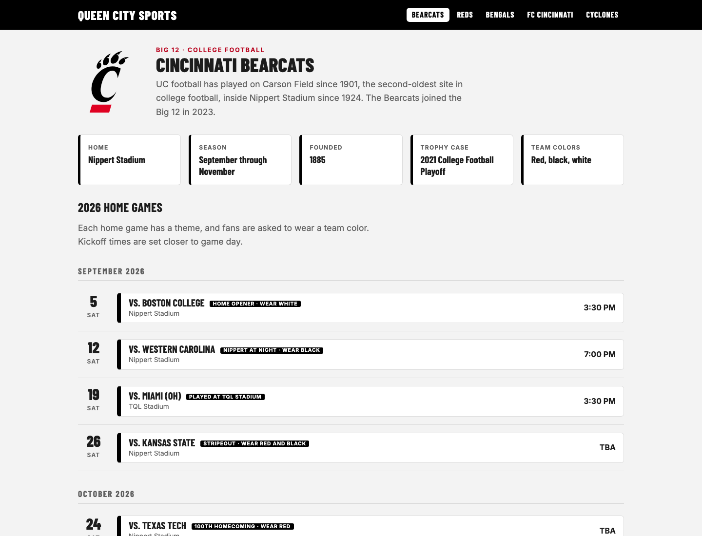
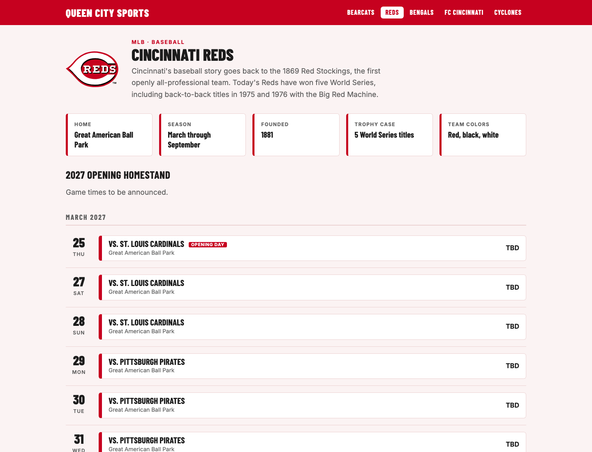
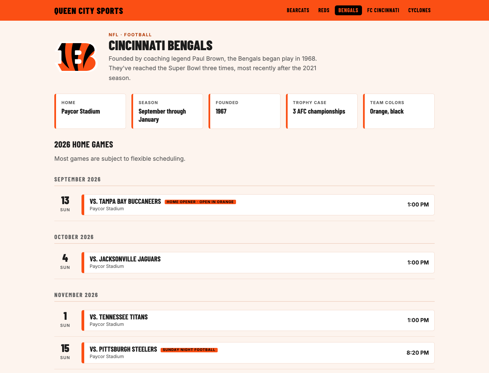
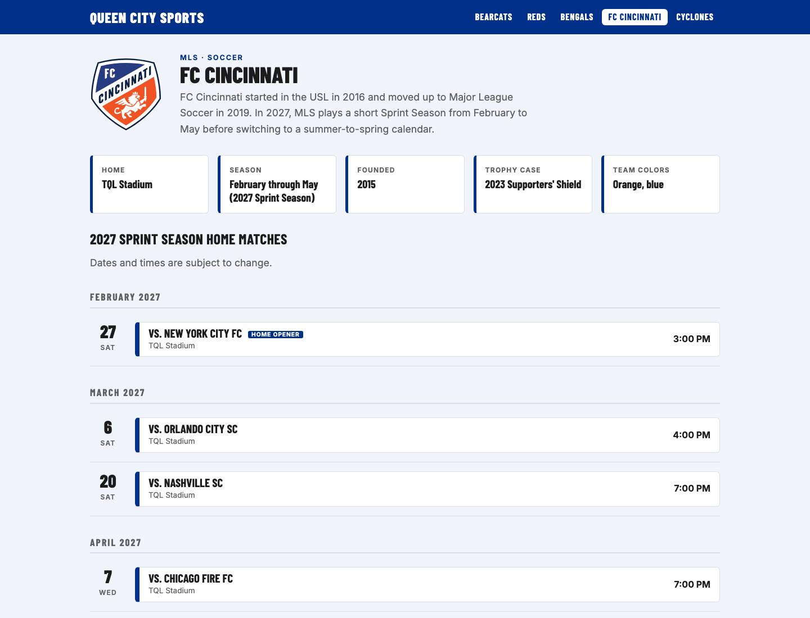
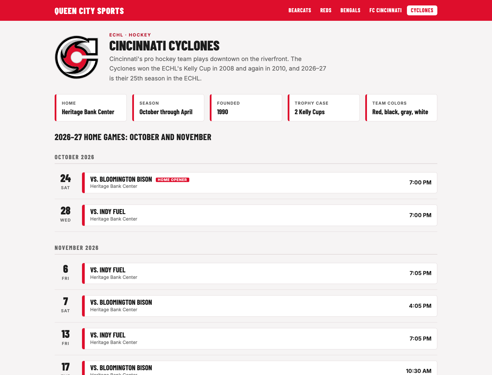

# 📄 Queen City Sports: Team Themes with CSS Variables

## 🎯 Overview

Queen City Sports has a home page and five team pages, and right now every page uses the same navy colors from
`css/base.css`. Your job is to give each team page its own colors **without writing a separate stylesheet for every
team**. You will replace the hard-coded colors in `base.css` with native CSS variables (custom properties), then give
each team a small tokens file that sets those variables. `base.css` stays shared, and each team page just links a
different tokens file.

## 📋 Requirements

### 1. Use variables in `base.css`

- [ ] Replace **every** hard-coded color in `css/base.css` with `var()`.
- [ ] Use these eight variable names exactly:

  | Variable | What it colors | Default (fallback) |
  | --- | --- | --- |
  | `--color-bg` | Page background | `#f7f5f0` |
  | `--color-surface` | Cards (team tiles, fact cards, game cards) | `#ffffff` |
  | `--color-text` | Main text | `#1c1c1c` |
  | `--color-muted` | Secondary text (descriptions, dates, footer) | `#5f5f5f` |
  | `--color-border` | Card borders and dividers | `#e1ddd3` |
  | `--color-accent` | Header, stripes, buttons, tags, current nav link text | `#1f3a5f` |
  | `--color-on-accent` | Text on top of the accent, current nav link background | `#ffffff` |
  | `--color-accent-text` | Small accent-colored text on the page background (`.kicker`) | `#1f3a5f` |

- [ ] Give every `var()` its original color as a fallback, for example `var(--color-accent, #1f3a5f)`. The home page
  has no tokens file, so the fallbacks are what keep it looking the same.

### 2. Create a tokens file for each team

- [ ] Make a `css/tokens/` folder with five files: `bearcats.css`, `reds.css`, `bengals.css`, `fc-cincinnati.css`
  and `cyclones.css`.
- [ ] Each file contains one `:root { }` rule that sets all eight variables. No other selectors.
- [ ] Pick colors from the team's real brand colors.

### 3. Link the tokens files

- [ ] Each team page links **its own** tokens file in the `<head>`, before `base.css`:

  ```html
  <link rel="stylesheet" href="../css/tokens/bearcats.css">
  <link rel="stylesheet" href="../css/base.css">
  ```

- [ ] `index.html` does **not** link a tokens file and looks exactly like it did before you started.

### 4. Keep it readable

- [ ] Text passes the WCAG AA contrast ratio of **4.5:1**. Check at least these pairs for every team:
  - `--color-on-accent` on `--color-accent` (header and tags)
  - `--color-accent-text` on `--color-bg` (`.kicker`)
  - `--color-accent` on `--color-on-accent` (current nav link)
- [ ] If a team's main color fails, use a darker shade for `--color-accent-text` or switch `--color-on-accent` to
  black. Add a comment in that tokens file explaining why.

### 5. Code quality

- [ ] Each tokens file starts with a comment that names the team.
- [ ] Use the same formatting as `base.css`: two-space indents, lowercase hex colors, one declaration per line.
- [ ] Do not change any HTML other than adding the `<link>` tags. Do not add inline styles.

## 🖼️ Example Output

These are the finished team pages at desktop width (1440px). Your colors can be slightly different, but each page
should clearly belong to its team.

| Bearcats | Reds |
| --- | --- |
|  |  |

| Bengals | FC Cincinnati |
| --- | --- |
|  |  |

| Cyclones |
| --- |
|  |

Things the screenshots don't show:

- The home page doesn't change at all. It keeps the default navy colors.
- Every page's background is a light tint of the team color, set by `--color-bg`.

## 📂 Starter Files

| File / Folder | Purpose | What you do |
| --- | --- | --- |
| `index.html` | Home page | Nothing. Leave it alone. |
| `team/*.html` | The five team pages | Add one `<link>` tag to each |
| `css/base.css` | Shared stylesheet for every page | Replace hard-coded colors with `var()` |
| `css/tokens/` | Team color tokens | Create this folder and its five files |
| `images/logos/` | Team logos | Nothing |

## 🧮 Grading

| Criteria | Full credit | Partial credit | No credit | Points |
| --- | --- | --- | --- | --- |
| **Variables in `base.css`** | Every hard-coded color uses `var()` with the correct variable name and the original color as a fallback | Most colors are replaced, or some fallbacks or names are wrong | Colors are still hard-coded | 4 |
| **Tokens files** | All five files exist in `css/tokens/` and each sets all eight variables inside `:root` | Some files or variables are missing, or other selectors are used | No tokens files | 4 |
| **Linking** | Each team page links its own tokens file before `base.css`; the home page links none | A page links the wrong file, links in the wrong order, or the home page links a tokens file | Tokens files aren't linked | 2 |
| **Home page unchanged** | The home page looks exactly like the starter | Small visual differences | The home page is broken or unstyled | 2 |
| **Color choices and contrast** | Colors match each team, and every pair listed in requirement 4 passes 4.5:1, with comments where a shade was adjusted | Colors match but one or two pairs fail, or adjustments aren't explained | Colors don't match the teams, or text is hard to read | 2 |
| **Code quality** | Formatting matches `base.css`, every tokens file has a header comment, no HTML changes beyond the `<link>` tags, clear commit messages | Some formatting issues, missing comments, or vague commits | Messy code, inline styles, or unrelated HTML changes | 1 |
| **Total** | | | | **15** |

## 📚 Resources

- [MDN: Using CSS custom properties (variables)](https://developer.mozilla.org/en-US/docs/Web/CSS/Using_CSS_custom_properties)
- [MDN: `var()`](https://developer.mozilla.org/en-US/docs/Web/CSS/var)
- [MDN: `:root`](https://developer.mozilla.org/en-US/docs/Web/CSS/:root)
- [WebAIM Contrast Checker](https://webaim.org/resources/contrastchecker/)

## 🆘 Getting Help

Ask during class or office hours, or post on the Canvas discussion board. If you're stuck on a color, check it in the
WebAIM Contrast Checker first.

---

The AI policy and submission instructions are in the [README](../README.md).
